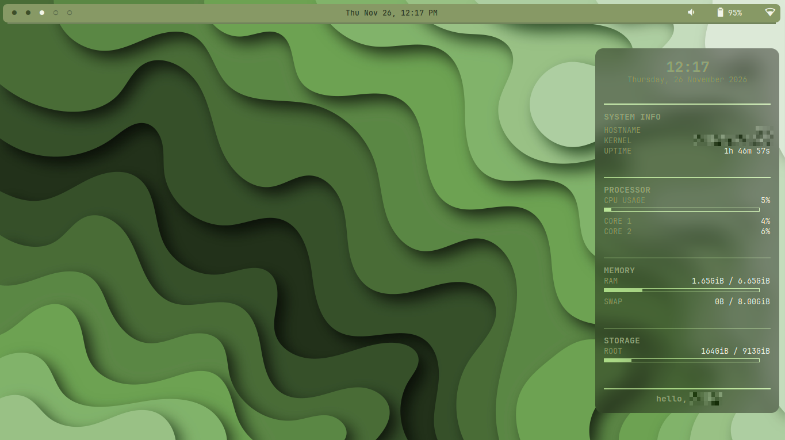

# Hello there
I'm particularly new to coding (I know some basics) and have recently started
I hope to get a lot of experience from this journey with hackclub

This repository is made for the bashed hackclub program

## Preview of how it should look like


## What I'll be doing
I'm going to be first making the dotfiles for my bspwm setup, then I'll add a `setup.sh` script that will essentially clone whatever is in this github repository and set up everyting (as the name implies).

### This will contain:
- bspwmrc : for bspwm
- sxhkdrc : for sxhd
- kitty.conf : for kitty terminal
- config.ini : for polybar
- picom.conf : for picom
- dunstrc : for dunst
- config.rasi : for rofi
    - modern.rasi : for easier theme management
- lock.sh : for i3lock-color
- conky.conf : for conky

## Requirenments (things to download)
### Essential
* bspwm
* sxhkd
* rofi
* kitty
* picom
* dunst
* polybar
* conky

# Quality of Life
* pactl
* brightnessctl
* i3lock-color
* feh

### Sources used:
- bspwm
    - [bspwm GitHub by Baskerville](https://github.com/baskerville/bspwm)
    - [Arch wiki for bspwm](https://wiki.archlinux.org/title/Bspwm)
    - [bspwm examples by Baskerville](https://github.com/baskerville/bspwm/tree/master/examples)
- sxhkd
    - [sxhkd GitHub by Baskerville](https://github.com/baskerville/sxhkd)
    - [sxhkd examples by Baskerville](https://github.com/baskerville/sxhkd/tree/master/examples)
- rofi
    - [rofi GitHub by Davatorium](https://github.com/davatorium/rofi)
    - [rofi examples by Davatorium](https://github.com/davatorium/rofi/tree/next/Examples)
    - [rofi documentation by Davatorium](https://davatorium.github.io/rofi/CONFIG/)
- polybar
    - [polybar GitHub](https://github.com/polybar/polybar)
    - [polybar docs](https://github.com/polybar/polybar/wiki)
    - bit's and pieces from [polybar-themes by adi1090x](https://github.com/adi1090x/polybar-themes)
- dunst
    - [dunst GitHub](https://github.com/dunst-project/dunst)
    - [dunst guide](https://github.com/dunst-project/dunst/wiki/Guides)
    - [dunst documentation](https://dunst-project.org/documentation/dunst/)
- picom (used claude in figuring out how to make the black stuff in the corners dissappear)
    - [picom Github by yshui](https://github.com/yshui/picom)
    - [picom docs](https://picom.app/)
- kitty
    - [kitty GitHub by Kovidgoyal](https://github.com/kovidgoyal/kitty)
    - [kitty documentation](https://sw.kovidgoyal.net/kitty/conf/)
    - [this random reddit thread](https://www.reddit.com/r/KittyTerminal/comments/1dmpk30/need_a_decent_kittyconf_file/)
- conky
    - [conky on Github by brndmtthws](https://github.com/brndnmtthws/conky)
    - [conky website](https://conky.cc/)
    - [bits and pieces from this repo by erikdubois](https://github.com/erikdubois/Aureola)
- i3lock-color
    -[i3lock-color by Raymo111](https://github.com/Raymo111/i3lock-color)
- feh
    - [wallpaper by soepratman on magnific.com](https://www.magnific.com/free-vector/abstract-paper-cut-green-background_418252745.htm#fromView=keyword&page=1&position=5&uuid=aa279933-32b1-485a-a991-06b6e698a193&track=ais_hybrid&query=Green+desktop+wallpapers)


## Seems important
### Always latest release's install.sh
```
curl -fsSL https://github.com/rajawatsid/dot-files_hackclub_bashed/releases/latest/download/install.sh | bash
```

### Or straight from main
```
curl -fsSL https://raw.githubusercontent.com/rajawatsid/dot-files_hackclub_bashed/main/install.sh | DOTFILES_REF=main bash
```
